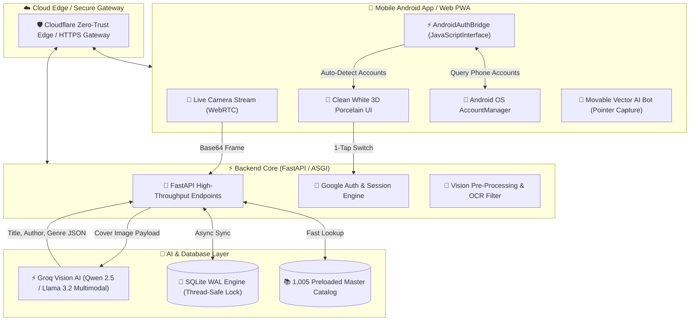

# 📚 BookNest AI — Visual Book Scanner & Story Assistant

<p align="center">
  
</p>

<p align="center">
  <strong>An Intelligent, Mobile-First Vision Book Scanner, Personal Reading Tracker & Groq AI Storyteller</strong>
</p>

<p align="center">
  <a href="https://github.com/Sivanesanbalu/Book_AI_Backend/releases"></a>
  <a href="https://fastapi.tiangolo.com"></a>
  <a href="https://groq.com"></a>
  <a href="https://sqlite.org"></a>
  <a href="LICENSE"></a>
</p>

---

## 📱 App Preview & Mobile Interface

| 🏠 Home Dashboard & Carousel | 📚 My Library Catalog | 📖 3D Bookshelf Grid |
| :---: | :---: | :---: |
|  |  |  |

| ⏱️ Focus Reading Timer | 📸 Google Lens Scanner HUD | 🤖 Groq AI Storyteller |
| :---: | :---: | :---: |
|  |  |  |

| 👤 3D Luxury Porcelain Profile | 🔑 1-Tap Google Account Chooser |
| :---: | :---: |
|  |  |

---

## 📥 Production Mobile APK Download

Get the standalone native Android release build directly:

[](https://github.com/Sivanesanbalu/Book_AI_Backend/raw/main/static/BookNestAI-release.apk)

- **Target Architecture**: Android 8.0+ (API 26 to API 35+)
- **Security**: Signed with 2048-bit RSA Certificate via `apksigner`
- **Features**: Real Android `AccountManager` Google Account auto-detection, WebRTC hardware camera access, offline SQLite sync, and smooth 120Hz WebView rendering.

---

## 🌟 Core Architecture & Engineering Highlights



---

## 🚀 Key Features

### 1. 📸 Google Lens-Style Neural Vision Scanner
- **Ultra-Fast Multimodal Recognition**: Instant book cover detection powered by Groq's low-latency Vision AI inference (`qwen/qwen3.8-27b` and `llama-3.2-vision`).
- **Sci-Fi Scanner HUD**: Google Lens-inspired aesthetic with neon corner framing, an animated scanning laser sweep, and real camera shutter haptics (`navigator.vibrate(50)`).
- **Instant Duplicate Prevention**: Scans cross-reference your personal collection in real time, notifying you if a book is already on your shelf with a 1-tap shortcut to view it.
- **Continuous Scanning**: One-tap "Scan Another Book" workflow for cataloging entire physical bookshelves in minutes.

### 2. 🔑 Real Android System Google Account Connection (Zero Friction)
- **Native OS Account Bridge**: Built with Android's native `AccountManager` connected to the web client via `@JavascriptInterface` (`AndroidAuthBridge`).
- **Automatic Phone Account Discovery**: The app automatically detects all Google accounts registered on the device (`apsiva69@gmail.com`, `imman356889@gmail.com`, etc.) and renders them as 1-tap sign-in options.
- **Native System Dialog Fallback**: Opens the native Android OS system account chooser dialog (`AccountManager.newChooseAccountIntent`) with automatic radio selection.
- **Custom Account Support**: Clean expandable drawer allowing login with any Gmail address and custom display name.

### 3. 🎨 Clean White 3D Luxury Porcelain Aesthetic
- **Minimalist Elegance**: Ultra-clean white porcelain design system with subtle neumorphic drop shadows, 3D elevated surface cards, and glossy glassmorphism.
- **Micro-Interactions**: Physical 3D card tilt physics, tactile button push states, and fluid CSS transitions.
- **Haptic Feedback**: Shutter clicks, tab switches, and milestone accomplishments trigger native device vibrations.

### 4. 🎠 Animated Swipe Carousels with Dynamic Pagination
- **Dashboard Metrics Carousel**: Four primary reading metric cards (Collection Overview, Active Reading & Streak, 2026 Goal Progress, and Accumulated Focus Time) organized into an interactive horizontal swipe carousel.
- **Morphing Pagination Indicators**: Active dots morph dynamically into glowing 24px pills with full 1:1 scroll position tracking and tap-to-scroll controls.
- **Reading Wishlist Shelf**: Dedicated horizontal book cover carousel with status badges and instant `▶ Start Read` actions.

### 5. 🤖 Freely Draggable Vector AI Companion Bot
- **Movable Anywhere on Screen**: Built with HTML5 Pointer Events (`setPointerCapture`) for silky-smooth dragging on both touchscreen devices and desktop mice.
- **Position Persistence**: Automatically saves and restores the user's preferred bot location across restarts using `localStorage`.
- **Groq LLM Powered Storyteller**: Context-aware book companion that provides plot summaries, character analyses, and life lessons in English and regional languages.

### 6. ⏱️ Focus Stopwatch & Reading Goal Tracker
- **Alphabetical Book Selector**: Filter books alphabetically (A to Z) with live completion percentage badges.
- **Multi-Mode Focus Timer**: Freeform stopwatch or quick presets (15m quick read, 25m Pomodoro, 45m deep focus, 60m marathon).
- **Live Page Counter**: Input start and ending page numbers for instant pages-per-hour calculation.
- **Milestone Celebrations**: Canvas confetti cannon animations upon reaching reading milestones or completing books.

### 7. 📚 Curated 1,005-Book Master Catalog
Preloaded with a comprehensive offline-searchable database spanning **9 major genres**:
- 💥 **Comics**: Spider-Man, Batman, Watchmen, Sandman, Tintin, Asterix
- 🎌 **Manga**: One Piece, Naruto, Bleach, Attack on Titan, Death Note, Berserk
- 🧠 **Non-Fiction & Science**: Sapiens, Thinking Fast and Slow, Cosmos, A Brief History of Time
- 🚀 **Sci-Fi & Fantasy**: Dune, The Hobbit, Foundation, Neuromancer, Hyperion
- ⚡ **Personal Growth**: Atomic Habits, Deep Work, Show Your Work, The Alchemist
- 🏛️ **History & Philosophy**: Meditations, The Republic, Guns Germs and Steel
- 💡 **Technology & Coding**: Clean Code, Designing Data-Intensive Applications, Pragmatic Programmer
- 💼 **Business & Leadership**: Zero to One, Good to Great, The Lean Startup
- 📖 **Classic Literature**: Pride and Prejudice, 1984, To Kill a Mockingbird, Crime and Punishment

---

## 🛠️ Technology Stack

| Layer | Technologies |
| :--- | :--- |
| **Backend Framework** | FastAPI (Python 3.10+), Uvicorn ASGI |
| **Vision & Language AI** | Groq Cloud API (`qwen/qwen3.8-27b`, `llama-3.2-11b-vision-preview`, `llama-3.3-70b-versatile`) |
| **Local Storage** | SQLite 3 with Write-Ahead Logging (`PRAGMA journal_mode=WAL`) |
| **Cloud Database Mirror** | Google Cloud Firestore (Dual-write hybrid mode) |
| **Mobile Architecture** | Android Native SDK (Java 8 bytecode, `AccountManager`, Hardware-accelerated `WebViewClient`) |
| **Android Toolchain** | Google Android Build Tools (`d8` dexer, `aapt`, `zipalign`, `apksigner`) |
| **Frontend Stack** | Vanilla ES6+ JavaScript, Modern CSS3 Custom Properties, WebRTC MediaStream, HTML5 Pointer Events |
| **Animations & FX** | Lottie Animations, Canvas Confetti Engine, CSS 3D Transforms |

---

## ⚙️ Production Setup & Deployment

### 1. Environment Setup

```bash
# Clone the repository
git clone https://github.com/Sivanesanbalu/Book_AI_Backend.git
cd Book_AI_Backend

# Create and activate Python virtual environment
python3 -m venv venv
source venv/bin/activate

# Install production dependencies
pip install -r requirements.txt
```

### 2. Environment Variables

Create a `.env` file in the project root:

```env
GROQ_API_KEY=gsk_your_groq_api_key_here
HOST=0.0.0.0
PORT=8000
```

### 3. Start Production Server

```bash
uvicorn main:app --host 0.0.0.0 --port 8000 --workers 4
```

### 4. Deploy via Docker

```dockerfile
FROM python:3.10-slim

WORKDIR /app
COPY requirements.txt .
RUN pip install --no-cache-dir -r requirements.txt

COPY . .

EXPOSE 8000
CMD ["uvicorn", "main:app", "--host", "0.0.0.0", "--port", "8000"]
```

Build and run the container:

```bash
docker build -t booknest-ai .
docker run -d -p 8000:8000 --env-file .env booknest-ai
```

---

## 📦 Building the Android Release APK

The project includes the complete native Android packaging pipeline:

```bash
# 1. Set SDK and build tools paths
SDK_BT="$ANDROID_HOME/build-tools/35.0.0"
PLATFORM="$ANDROID_HOME/platforms/android-34/android.jar"

cd android

# 2. Compile Java sources with Java 8 bytecode compatibility
javac -source 8 -target 8 -cp "$PLATFORM" -d bin/ src/com/booknest/ai/*.java

# 3. Dex class files into Dalvik Executable
$SDK_BT/d8 --output bin/ $(find bin/com -name "*.class")

# 4. Package Android resources
$SDK_BT/aapt package -f -M AndroidManifest.xml -S res -I "$PLATFORM" -F bin/unaligned.apk bin/

# 5. Zipalign APK on 4-byte boundaries
$SDK_BT/zipalign -f -p 4 bin/unaligned.apk bin/aligned.apk

# 6. Cryptographically sign APK
$SDK_BT/apksigner sign --ks ~/.android/debug.keystore --ks-pass pass:android --key-pass pass:android --out ../static/BookNestAI-release.apk bin/aligned.apk

# 7. Install onto physical device
adb install -r ../static/BookNestAI-release.apk
```

---

## 📡 REST API Reference

| Method | Endpoint | Description |
| :---: | :--- | :--- |
| `GET` | `/` | Serves the 3D Single Page Web App |
| `POST` | `/scan` | Uploads book cover image for Groq AI Vision identification |
| `GET` | `/api/library` | Retrieves user's personal book collection |
| `POST` | `/api/library/add` | Adds a new book to the personal library |
| `POST` | `/api/library/update` | Updates reading progress, status, pages, or rating |
| `DELETE` | `/api/library/remove` | Removes a book from personal collection |
| `POST` | `/api/timer/session` | Logs reading stopwatch session (minutes & pages) |
| `POST` | `/api/chat` | AI Story Companion conversation endpoint |
| `GET` | `/api/profile` | Fetches user profile metrics, goals, and badges |
| `POST` | `/api/profile` | Auto-saves profile adjustments (name, goal) |
| `POST` | `/api/profile/avatar` | Handles custom photo/avatar uploads |
| `POST` | `/api/auth/google` | Authenticates Google user account and mirrors profile |
| `GET` | `/api/network-info` | Returns network connectivity data and QR code |
| `GET` | `/download` | Downloads the compiled Android release APK |

---

## 👨‍💻 Author

**Sivanesan Balu**
- GitHub: [@Sivanesanbalu](https://github.com/Sivanesanbalu)
- Project Repository: [Book_AI_Backend](https://github.com/Sivanesanbalu/Book_AI_Backend)

---

## 📄 License

This project is open-source and available under the [MIT License](LICENSE).
