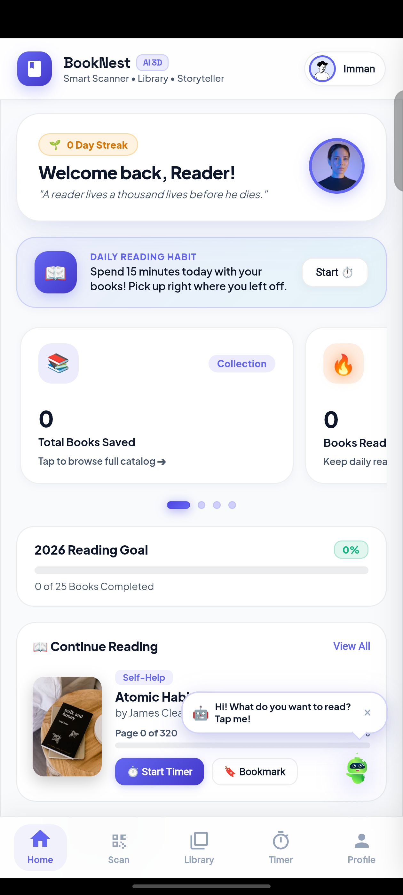
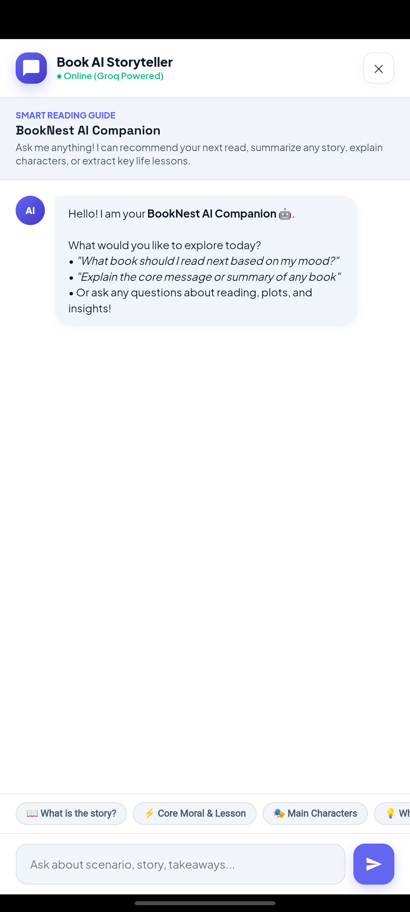

# BookNest AI

BookNest AI helps readers turn a photo of a book cover into a library entry. Scan a cover, check whether the book is already on your shelf, and save it. When you pick it up again, the reading timer records your minutes and pages. A book-aware chat assistant can discuss the plot, characters, or themes using the selected book’s metadata.

| Reading dashboard | Book chat |
| :---: | :---: |
|  |  |

## Run locally

Docker runs the FastAPI backend and serves the web app from the same address. The library, reading timer, and catalog work without API keys.

```bash
git clone https://github.com/Sivanesanbalu/Book_AI_Backend.git
cd Book_AI_Backend
docker build --platform linux/amd64 -t booknest-ai .
docker run --rm --platform linux/amd64 \
  -p 127.0.0.1:8000:10000 \
  -v booknest-data:/app/data \
  -v booknest-avatars:/app/static/avatars \
  -e GROQ_API_KEY -e FIREBASE_KEY \
  booknest-ai
```

Open the [web app](http://127.0.0.1:8000/) or explore the [interactive API docs](http://127.0.0.1:8000/docs). The container listens on port `10000`. The two named volumes keep your library, catalog changes, and uploaded avatars between runs.

<details>
<summary>Run directly with Python 3.10 on x86-64 Linux</summary>

From the repository root, install the pinned CPU dependencies and start Uvicorn.

```bash
python3.10 -m venv .venv
source .venv/bin/activate
python -m pip install -r requirements.txt
python -m uvicorn main:app --host 127.0.0.1 --port 8000
```

</details>

## Try the library API

Add a book to the local guest library, log a reading session, then fetch the entry to see its updated page and reading time.

```bash
curl -X POST http://127.0.0.1:8000/api/library/add \
  -H 'Content-Type: application/json' \
  -d '{"title":"The Time Machine","author":"H. G. Wells","genre":"Science Fiction"}'

curl -X POST http://127.0.0.1:8000/api/reading/log \
  -H 'Content-Type: application/json' \
  -d '{"title":"The Time Machine","minutes":20,"start_page":1,"end_page":16}'

curl http://127.0.0.1:8000/api/library
```

Requests without an authorization header share the same guest library. The local account picker is intended for demo use.

## How cover recognition works

1. The web app sends a camera photo or uploaded image to `POST /scan`. The endpoint accepts a multipart field named `file` and limits each image to 10 MiB.
2. The backend compares the image with indexed covers using ConvNeXt embeddings or a perceptual fingerprint. The bundled catalog contains 1,005 metadata records for recommendations. Cover vectors are added separately through `POST /add`.
3. When local matching misses and Groq is configured, the backend sends the image to Groq for title recognition. It looks up the result in Google Books, with Open Library as a fallback.
4. The scanner returns `found`, `owned`, or `not_found`. Check the preview before saving. The current local index can pair a cover with the wrong title when catalog entries with and without vectors appear together.

## Optional integrations

Set these environment variables in the launching shell before starting the server or running the container.

| Variable | What it enables |
| --- | --- |
| `GROQ_API_KEY` | Remote cover recognition and generated book discussions when the configured models are available. Without a key, the chat assistant uses built-in responses. |
| `FIREBASE_KEY` | Firebase Admin service-account JSON for ID-token verification and Firestore book operations. SQLite still stores the local library, profiles, and reading sessions in `data/library.db`. |

## Android

The Android client opens the web app in a WebView. Its backend address is set by `APP_URL` in the activity source. To use your own deployment, set that address before rebuilding the APK. [Android source](android/src/com/booknest/ai/MainActivity.java) · [Download the APK](https://github.com/Sivanesanbalu/Book_AI_Backend/releases/download/v1.0.0/BookNestAI-release.apk)

## Code map

| Path | Responsibility |
| --- | --- |
| [`main.py`](main.py) | FastAPI routes for scans, library entries, reading sessions, recommendations, and chat |
| [`image_embedder.py`](image_embedder.py) and [`image_search.py`](image_search.py) | Cover features and similarity search with FAISS or NumPy |
| [`vision_ai/`](vision_ai/) | Groq integration, metadata lookups, and book discussions |
| [`firebase_service.py`](firebase_service.py) | SQLite persistence and optional Firebase integration |
| [`static/`](static/) | Web interface, assets, and downloadable Android package |

Maintained by [Sivanesan Balu](https://github.com/Sivanesanbalu).
