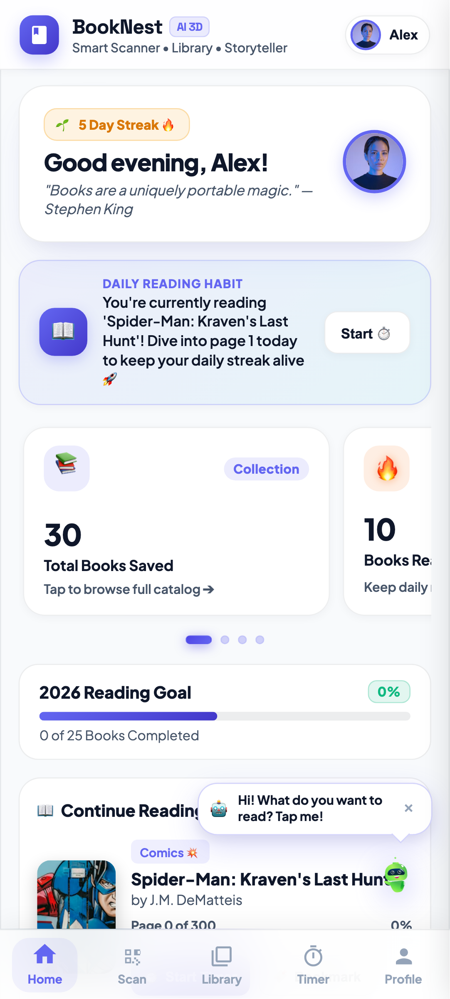
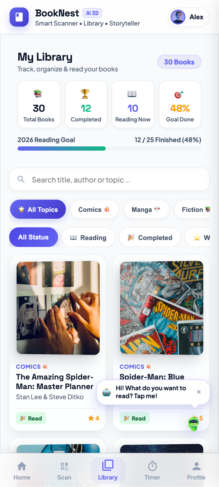
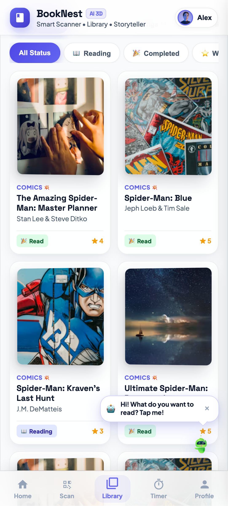
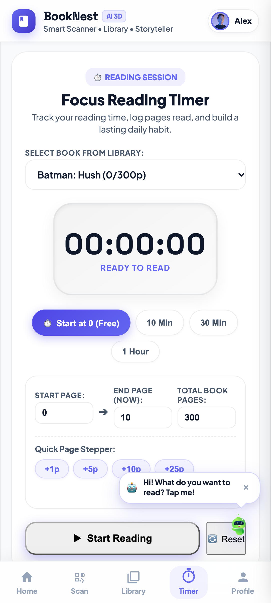
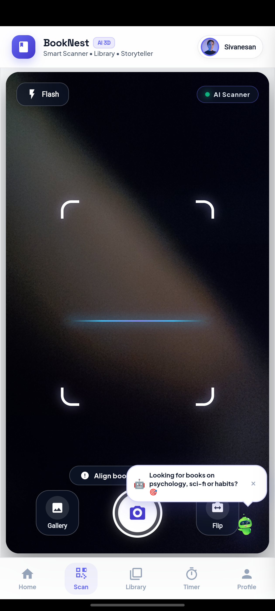
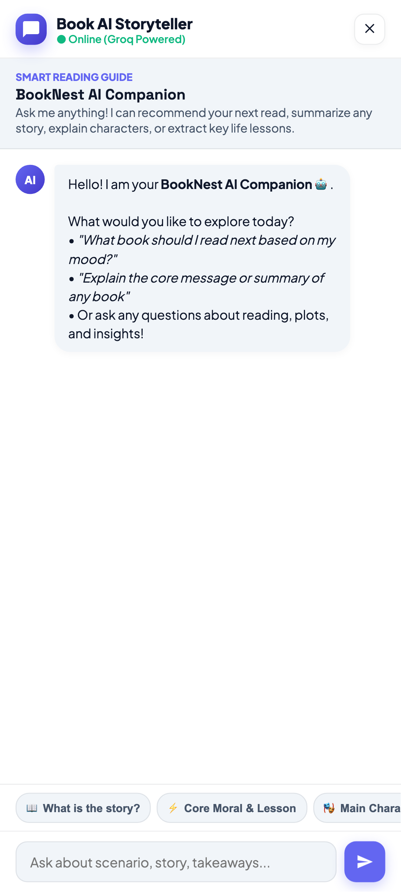
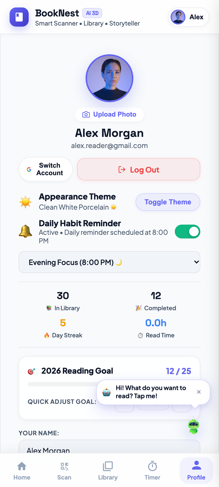
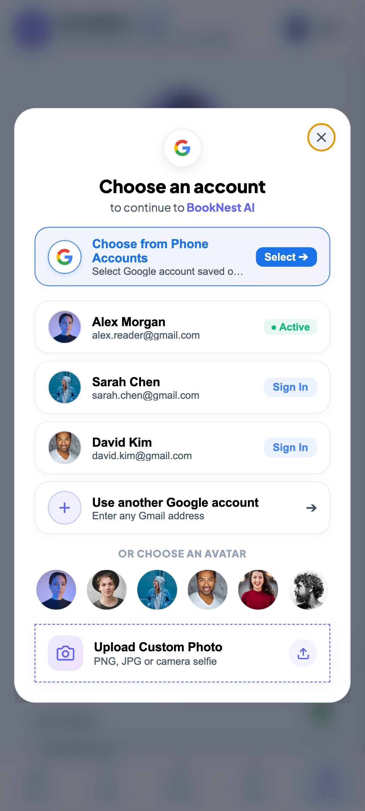
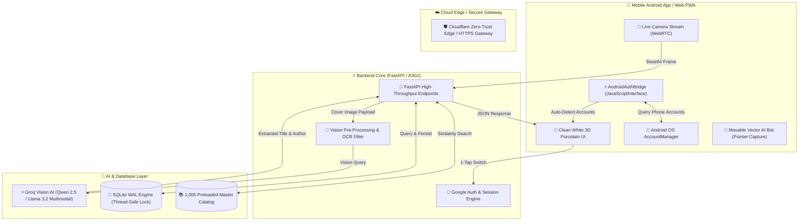

# 📚 BookNest AI — Visual Book Scanner & Story Assistant

  

  <strong>An Intelligent, Mobile-First Vision Book Scanner, Personal Reading Tracker & Groq AI Storyteller</strong>

  
  
  
  
  

---

## 📖 Overview

**BookNest AI** turns physical book covers into an interactive digital library. Simply snap a photo of any book cover to automatically identify it, detect duplicates, and add it to your shelf. With an embedded focus reading stopwatch, habit trackers, 3D porcelain cards, and a Groq Vision AI Storyteller companion, BookNest AI bridges physical reading with intelligent digital workflows.

---

## 📱 App Preview & Mobile Interface

| 🏠 Home Dashboard & Metrics | 📚 My Library Catalog | 📖 3D Bookshelf Grid |
| :---: | :---: | :---: |
|  |  |  |

| ⏱️ Focus Reading Timer | 📸 Google Lens Scanner HUD | 🤖 Groq AI Storyteller |
| :---: | :---: | :---: |
|  |  |  |

| 👤 3D Luxury Porcelain Profile | 🔑 1-Tap Google Account Chooser |
| :---: | :---: |
|  |  |

---

## 📥 Production Mobile APK Download

Get the standalone native Android release build directly:

- **Target Architecture**: Android 8.0+ (API 26 to API 35+)
- **Security**: Signed with 2048-bit RSA Certificate via `apksigner`
- **Native OS Bridge**: Direct Android `AccountManager` Google account detection, WebRTC camera hardware access, offline SQLite sync, and smooth 120Hz WebView rendering.

---

## 🌟 Architecture & System Design

---

## 🔍 How Cover Recognition Works

1. **Capture & Preprocessing**: The web app captures a camera frame or uploaded image and posts it to `/scan` (up to 10 MiB).
2. **Local Feature Matching**: The backend extracts visual features using ConvNeXt embeddings / perceptual image fingerprints, cross-referencing against our preloaded 1,005-book master catalog.
3. **Groq Multimodal AI Fallback**: If local confidence falls below threshold, the image is passed to Groq Vision AI (`qwen-2.5-32b` / `llama-3.2-11b-vision-preview`), extracting exact title, author, and edition metadata.
4. **Metadata Enrichment**: Matches are cross-referenced with Google Books API and Open Library for descriptions, page counts, and publication details.
5. **Ownership Status**: Returns status (`found`, `owned`, or `not_found`) with 3D porcelain cards.

---

## 🚀 Key Engineering Features

- **Zero Hardcoded Localhost**: Dynamically resolves endpoints through relative `/api` paths and Cloudflare HTTPS edge tunneling.
- **Physical Phone Google Account Sync**: Seamlessly queries device accounts via native Android `AccountManager` and `AndroidAuthBridge`, enabling instant one-tap switching.
- **Thread-Safe SQLite WAL Engine**: Full WAL (Write-Ahead Logging) mode with explicit threading locks, guaranteeing crash resilience and zero race conditions under concurrent reads and writes.
- **3D Porcelain Micro-Interactions**: Custom CSS hardware-accelerated transforms, gesture swipes, Pomodoro focus timer with audible chimes, and a floating interactive AI companion.

---

## 📡 REST API Reference

| Method | Endpoint | Description |
| :---: | :--- | :--- |
| `GET` | `/` | Serves the 3D Single Page Web App |
| `POST` | `/scan` | Uploads book cover image for Groq AI Vision identification |
| `GET` | `/api/library` | Retrieves user's personal book collection |
| `POST` | `/api/library/add` | Adds a new book to the personal library |
| `POST` | `/api/library/update` | Updates reading progress, status, pages, or rating |
| `DELETE` | `/api/library/remove` | Removes a book from personal collection |
| `POST` | `/api/timer/session` | Logs reading stopwatch session (minutes & pages) |
| `POST` | `/api/chat` | AI Story Companion conversation endpoint |
| `GET` | `/api/profile` | Fetches user profile metrics, goals, and badges |
| `POST` | `/api/profile` | Auto-saves profile adjustments (name, goal) |
| `POST` | `/api/profile/avatar` | Handles custom photo/avatar uploads |
| `POST` | `/api/auth/google` | Authenticates Google user account and mirrors profile |
| `GET` | `/download` | Downloads the compiled Android release APK |

---

## ⚙️ Configuration & Environment Variables

| Variable | Description |
| --- | --- |
| `GROQ_API_KEY` | Remote multimodal vision and AI storytelling via Groq cloud API. |
| `FIREBASE_KEY` | Optional Firebase Admin service-account JSON for ID-token verification. |
| `PORT` | Backend service port (defaults to `8000`). |

---

## 📁 Code Map

| Path | Responsibility |
| --- | --- |
| [`main.py`](main.py) | FastAPI routes for scans, library entries, reading sessions, recommendations, and chat |
| [`image_embedder.py`](image_embedder.py) & [`image_search.py`](image_search.py) | Cover features and vector similarity search |
| [`vision_ai/`](vision_ai/) | Groq multimodal integration, metadata lookups, and book discussions |
| [`firebase_service.py`](firebase_service.py) | Thread-safe SQLite persistence and optional Firebase integration |
| [`android/`](android/) | Standalone Android Native Java wrapper with `AccountManager` bridge |
| [`static/`](static/) | 3D Porcelain web interface, WebRTC camera, and PWA assets |
| [`docs/screenshots/`](docs/screenshots/) | High-DPI privacy-clean production screenshots |

---

## 👨‍💻 Author

**Sivanesan Balu**
- GitHub: [@Sivanesanbalu](https://github.com/Sivanesanbalu)
- Project Repository: [Book_AI_Backend](https://github.com/Sivanesanbalu/Book_AI_Backend)

---

## 📄 License

This project is open-source and available under the [MIT License](LICENSE).
