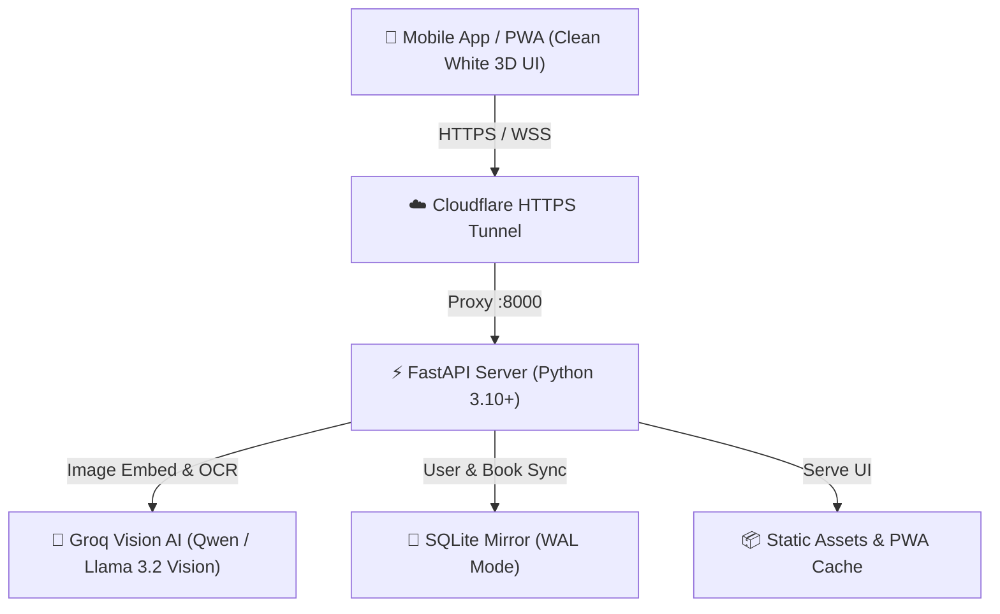

# 📚 BookNest AI — Visual Book Scanner & Story Assistant

[](https://fastapi.tiangolo.com)
[](https://www.python.org/)
[](https://groq.com)
[](https://sqlite.org)
[](https://developer.android.com)
[](LICENSE)

An intelligent, mobile-first book scanner and personal reading companion featuring a **1,005+ book preloaded catalog**, **Groq Multimodal Vision AI**, an interactive **Reading Stopwatch**, an **interactive swipe carousel with pagination dots**, and a **freely draggable Vector AI Companion Bot**.

---

## 🔗 Live Access & Downloads

- 💻 **Desktop Web App**: [http://localhost:8000](http://localhost:8000)
- 📱 **Mobile Cloudflare HTTPS Tunnel**: [https://connector-fixes-mitsubishi-mac.trycloudflare.com](https://connector-fixes-mitsubishi-mac.trycloudflare.com)
- 📥 **Android Release APK**: [Download BookNest AI Release APK](https://github.com/Sivanesanbalu/Book_AI_Backend/releases/download/v1.0.0/BookNestAI-release.apk)

---

## 🌟 Key Features

### 1. 📸 Google Lens Camera HUD & Vision AI Scanner
- **Neural Multimodal Vision**: Point your phone camera or webcam at physical book covers; powered by Groq's high-speed vision AI (`qwen/qwen3.8-27b`).
- **Sci-Fi Google Lens HUD**: Features neon cyan/indigo corner brackets, an animated scanning laser sweep, and a rotating central focus reticle.
- **Haptic & Visual Feedback**: Integrated shutter haptics (`navigator.vibrate(50)`) and flash effect on capture.
- **Instant Library Check**: Checks if a book is already in your personal collection with a 1-tap shortcut to view it.
- **"Scan Another Book" Action**: Seamless 1-tap reset to dismiss the result card and immediately continue scanning.
- **Distraction-Free Framing**: Floating AI bot automatically hides while the camera scanner is active to ensure unobstructed view.

### 2. 🎠 Dashboard Metrics Swipe Carousel with Pagination Dots
- **Horizontal Snap Carousel**: Four high-priority reading metric cards placed directly beneath the greeting header:
  1. 📚 **Collection Overview**: Total books saved with 1-tap shortcut to full library.
  2. 🔥 **Reading Now & Live Streak**: Active reading count with live streak flame indicator.
  3. 🎉 **2026 Goal Progress**: Completed book count with goal badge and animated mini progress bar.
  4. ⏱️ **Focus Time**: Total accumulated reading time with quick link to Stopwatch.
- **Interactive Carousel Dots**: 4 pagination dots morph dynamically (active dot expands into a 24px glowing pill) as you swipe left/right, with 1:1 tap-to-scroll navigation.

### 3. ⭐ Reading Wishlist Shelf with Dynamic Pagination
- **Horizontal Shelf Preview**: Displays top Wishlist books with physical 3D card tilt and direct `▶ Start Read` actions.
- **Interactive Carousel Dots**: Dedicated pagination dots track and center cards smoothly with 1:1 scroll synchronization.
- **Curated "+ More Books" Card**: Directly routes users with larger wishlists to the dedicated Library Wishlist filter.

### 4. 🤖 Freely Draggable Vector AI Companion Bot
- **Clean Vector Character**: Minimalist animated robot companion with soft drop shadow (no background container circles).
- **Smooth Pointer Capture Dragging**: Smooth HTML5 Pointer Events (`setPointerCapture`) allow dragging the bot anywhere on screen on both touch and mouse.
- **Position Persistence**: Automatically remembers user's preferred screen position in `localStorage` (`booknest_ai_bot_pos`).
- **Contextual Speech Bubble**: Offers reading encouragement, daily recommendations, and launches interactive book chats.

### 5. ⏱️ Reading Stopwatch & Live Page Tracker
- **A to Z Book Selection**: Alphabetically sorted dropdown with status and progress badges for easy book picking.
- **Flexible Stopwatch**: Freeform stopwatch or preset durations (15m, 25m Pomodoro, 45m Deep Work, 60m Marathon).
- **Live Page Counter**: Input start and end pages to see instant pages-read delta calculation.
- **Celebration Modal**: Full-screen confetti cannon animation on completing books or reading milestones.

### 6. 📚 1,005 Preloaded Books across 9 Categories
Explore and filter a curated master catalog of **1,005 books**:
- 💥 **Comics**: Spider-Man, Batman, Watchmen, Sandman, Tintin, Asterix
- 🎌 **Manga**: One Piece, Naruto, Bleach, Attack on Titan, Death Note, Demon Slayer
- 📚 **Fiction**: Harry Potter, Lord of the Rings, 1984, To Kill a Mockingbird
- 🚀 **Sci-Fi & Fantasy**: Dune, Foundation, Neuromancer, Three-Body Problem
- 💡 **Self-Help**: Atomic Habits, Deep Work, Think & Grow Rich, Ikigai
- 💻 **Technology & Code**: Clean Code, Pragmatic Programmer, Designing Data-Intensive Apps
- 🕵️ **Mystery & Thriller**: Sherlock Holmes, Da Vinci Code, Gone Girl, Agatha Christie
- 📜 **History & Bio**: Sapiens, Steve Jobs, Wings of Fire, Ponniyin Selvan
- 💼 **Business & Finance**: Zero to One, Psychology of Money, The Intelligent Investor

### 7. ⚪ Clean White Porcelain 3D Luxury Design
- Modern porcelain white glassmorphic aesthetic with 3D card elevation and soft shadows.
- Physical 3D book cover tilt with realistic spine depth and specular highlights.
- **Theme Switcher**: 1-click toggle between **Clean White Porcelain ☀️** and **Dark Luxury Midnight 🌙**.

### 8. ⚡ Zero-Click Profile Auto-Save & Google Auth
- **Instant Auto-Save**: Name edits and reading goal adjustments (`-5` / `+5`) automatically persist to localStorage and SQLite server with subtle `✓ Auto-saved` status indicator.
- **Google Sign-In**: 1-tap authentication syncing your library and profile state across devices.
- **Custom Avatars**: Tap avatar to upload custom images or choose from 3D presets.

---

## 🛠️ Architecture & Tech Stack



- **Backend**: FastAPI, Uvicorn, Python 3.10+
- **Vision AI**: Groq Cloud SDK (`qwen/qwen3.8-27b`, `llama-3.2-11b-vision-preview`)
- **Database**: SQLite with Write-Ahead Logging (WAL) for concurrency & crash resilience
- **Frontend**: Vanilla JS (ES6+), Modern CSS3 Custom Properties, 3D Canvas, HTML5 WebRTC & Pointer Events
- **Mobile Wrapper**: Native Android WebView (API 24+) with Fullscreen Hardware Acceleration

---

## 🚀 Getting Started

### Prerequisites
- Python 3.10 or higher
- pip & virtualenv
- Android SDK / ADB (optional, for running on physical Android devices)
- Groq Cloud API Key ([Get one here](https://console.groq.com))

### 1. Installation

```bash
# Clone the repository
git clone https://github.com/Sivanesanbalu/Book_AI_Backend.git
cd Book_AI_Backend

# Create and activate virtual environment
python3 -m venv venv
source venv/bin/activate

# Install dependencies
pip install -r requirements.txt
```

### 2. Configuration

Create a `.env` file in the root directory:

```env
GROQ_API_KEY=gsk_your_groq_api_key_here
PORT=8000
HOST=0.0.0.0
```

### 3. Run the Backend Server

```bash
python3 -m uvicorn main:app --host 0.0.0.0 --port 8000 --reload
```

Access the web interface at **`http://localhost:8000`**.

### 4. Run on Mobile Device via Cloudflare Tunnel

```bash
# Start Cloudflare HTTP2 tunnel
cloudflared tunnel --protocol http2 --url http://localhost:8000
```

Copy the generated `https://*.trycloudflare.com` URL and open it on your mobile device or update `MainActivity.java`.

### 5. Install & Run on Android Device (via ADB)

```bash
# Ensure your Android phone has USB Debugging enabled
adb devices

# Install pre-built signed APK
adb install -r static/BookNestAI-release.apk

# Launch BookNest AI
adb shell am start -n com.booknest.ai/.MainActivity
```

---

## 📁 Repository Structure

```text
Book_AI_Backend/
├── main.py                  # FastAPI server, endpoints & router
├── firebase_service.py      # SQLite persistence layer (WAL mode)
├── vision_ai/
│   ├── vision.py            # Groq multimodal vision cover recognition
│   ├── ai_summary.py        # AI storyteller & narrative generator
│   └── book_fetcher.py      # Google Books & OpenLibrary fallback
├── data/
│   └── books.json           # 1,005 books master catalog database
├── static/
│   ├── index.html           # Main Single Page App (PWA)
│   ├── css/app.css          # Clean White 3D luxury stylesheet
│   ├── js/app.js            # Frontend reactive engine, bot & timer
│   ├── manifest.json        # PWA configuration
│   └── BookNestAI-release.apk # Production signed Android release APK
├── templates/
│   └── index.html           # Server-side Jinja template mirror
├── android/
│   ├── AndroidManifest.xml  # Android app manifest with camera permissions
│   ├── src/                 # Native Java WebView wrapper (MainActivity.java)
│   └── res/                 # App icons, layouts & resources
└── scripts/
    └── generate_1000_books.py # 1,005 catalog seeder script
```

---

## 📡 API Endpoints

| Method | Endpoint | Description |
| :---: | :--- | :--- |
| `GET` | `/` | Serves the 3D Single Page Web App |
| `POST` | `/scan` | Uploads book cover image for AI Vision identification |
| `GET` | `/api/library` | Retrieves user's personal book collection |
| `POST` | `/api/library/add` | Saves a book with status and category |
| `POST` | `/api/library/update` | Updates reading progress, status, pages, or rating |
| `DELETE` | `/api/library/remove` | Removes a book from personal collection |
| `POST` | `/api/timer/session` | Logs reading stopwatch session (minutes & pages) |
| `POST` | `/api/chat` | Communicates with the AI Story Companion |
| `GET` | `/api/profile` | Fetches user profile metrics and goals |
| `POST` | `/api/profile` | Auto-saves user profile name and reading goals |
| `POST` | `/api/auth/google` | Authenticates Google user account |
| `GET` | `/api/network-info` | Returns local and tunnel network URLs + QR code |
| `GET` | `/download` | Downloads production signed Android release APK |

---

## 📄 License

This project is licensed under the MIT License — see the [LICENSE](LICENSE) file for details.

---

<p align="center">
  Crafted with ❤️ for book lovers everywhere.
</p>
